# DeskMason · 桌面瓦匠

把常用文件夹和随手工具做成贴在桌面上的「瓦片」。

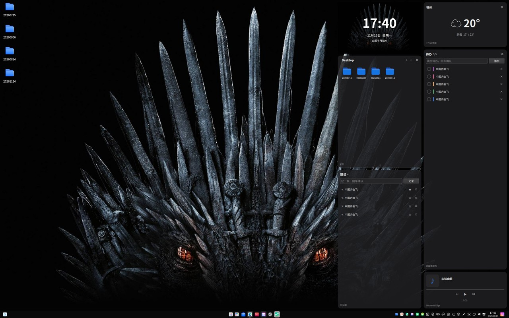

瓦片不是普通窗口，而是挂在桌面层的常驻面板：始终位于桌面图标之上、日常应用窗口之下。点桌面空白处不会消失，也不会挡住正在用的程序——它像贴在桌面上的一块砖，需要时抬眼即见，不需要时安静待在原地。

**本地优先**：布局、设置、待办与随记全部存在本机，不需要账号、不连云端、不上传任何数据。文件瓦片只是引用文件夹，文件本身仍在原来的位置。

---

## 为什么是瓦片

普通应用窗口的问题在于「切换成本」：想看今天的待办，得先找到并前台化那个窗口，看完再切回来。瓦片把这件事变成零成本——信息常驻在桌面可见范围内，但又不占据前台。

为此约束只有三条，都很硬：

1. **层级固定**。瓦片挂在桌面层，永远在桌面图标之上、普通窗口之下。拉开一个编辑器，该被盖住就被盖住，不抢视线。
2. **只占托盘**。所有窗口（瓦片、设置、引导）在任务栏都不留条目，任务栏里只有托盘图标一个入口。桌面工具不该在切换器里占坑。
3. **不抢焦点**。只有含输入框的瓦片接受 X 键盘焦点，纯展示瓦片一律不抢——否则会和 fcitx5 的输入上下文反复切换，中文输入直接崩。

## 六种瓦片

### 文件格子

绑定任意文件夹，展示并打开文件、拖放、排序、视图密度。顶部 `＋` 只能再建一个文件格子，且必须选择**新的**文件夹路径。文件夹内容变了，瓦片跟着变；瓦片删了，文件一个不少。

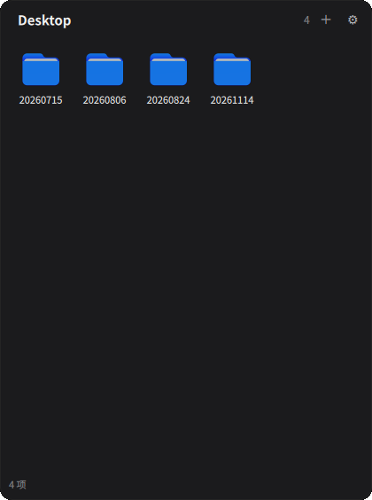

文件格子可以存在多个，每个绑定不同目录。

### 待办

新增与勾选、未完成／全部／已完成筛选、单条详情（标题、备注、到期、步骤）、颜色标记。

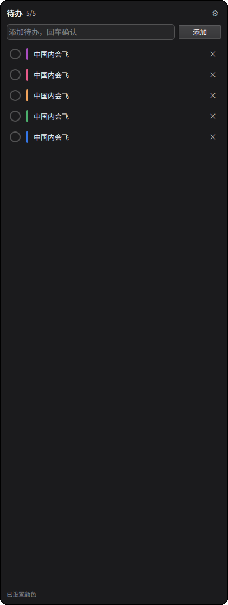

### 随记

随手记录，点击单条查看全文并支持复制。适合放临时剪贴内容。

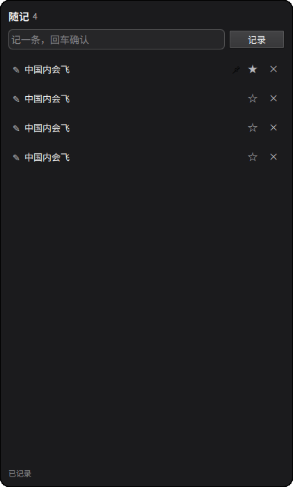

### 时光

时钟、日期、星期、农历、节气与节日。可用当前桌面壁纸作背景，也可在设置里自定义或关闭。

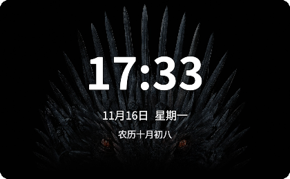

### 天气

城市设置（中文／英文输入均可）、当前天气与预报。离线时降级展示。

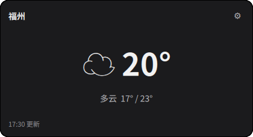

### 音乐

通过 MPRIS 控制系统播放器，封面、进度、播放状态同步。

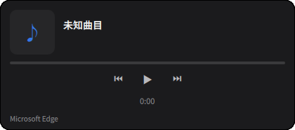

除文件格子外，其余五种瓦片都是**全局单例**：只能在设置里开启或关闭，不会重复创建。

## 设置

设置窗是一个独立的无边框面板，七页、二十四项，左侧导航加顶栏过滤。所有开关即时生效、即时落盘。

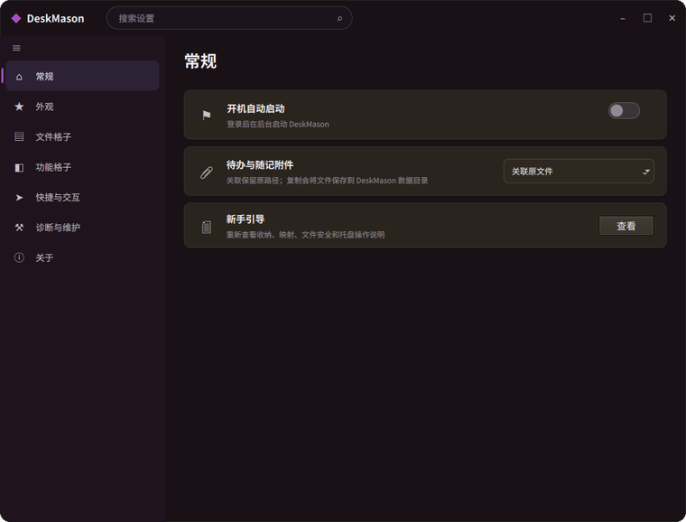

| 页面 | 内容 |
| --- | --- |
| 常规 | 开机自动启动、待办与随记附件策略、新手引导 |
| 外观 | 应用主题、托盘图标、时光背景 |
| 文件格子 | 文件显示、自动叠放、收纳与路径、文件名与排序默认值 |
| 功能格子 | 随记、待办、音乐、天气、时光的开关与细化 |
| 快捷与交互 | 全局快捷键、悬浮操作、窗口与鼠标行为 |
| 诊断与维护 | 本地备份、备份目录 |
| 关于 | 应用说明、版本、数据目录 |

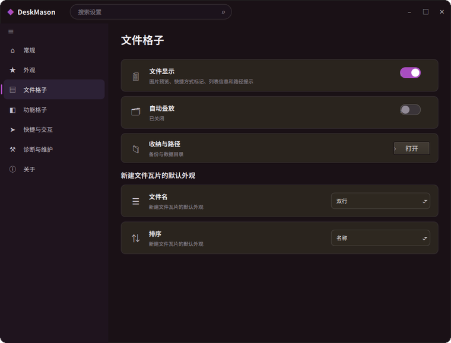

窗口材质固定为云母（KWin 模糊 + 0.72 不透明度），深浅色跟随系统主题。这些不提供开关——固定下来少一个要调的旋钮，界面反而稳定。

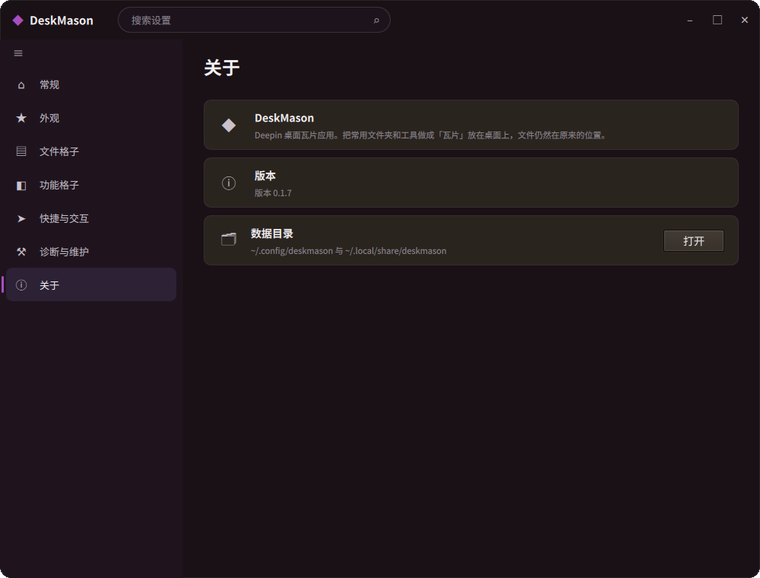

<details>
<summary>其余页面截图</summary>

<p>
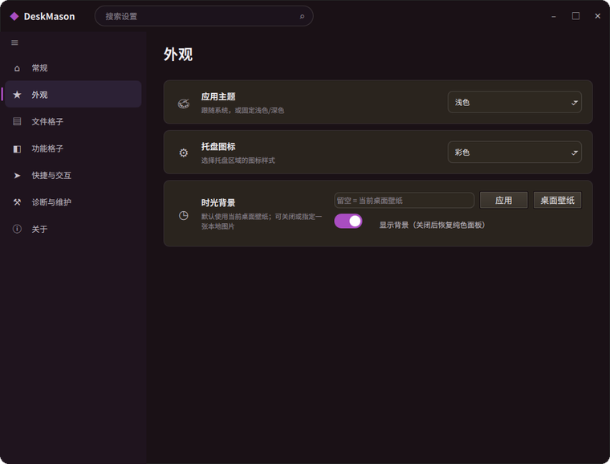
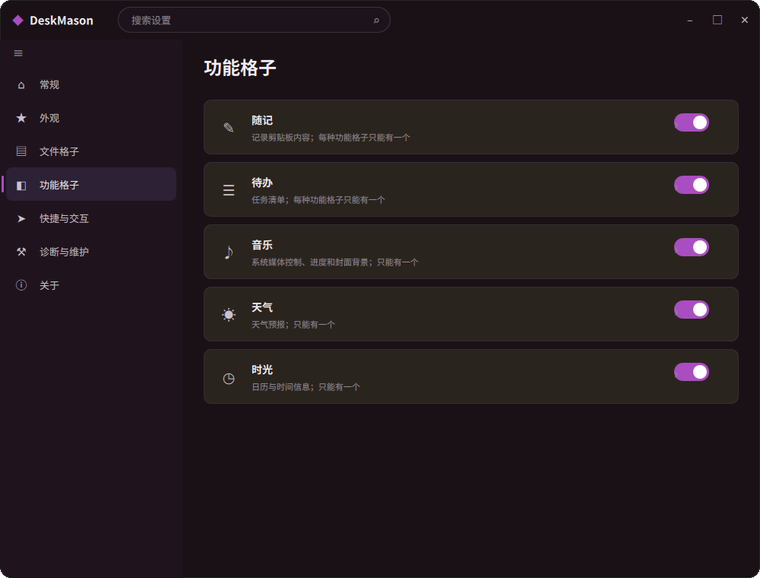
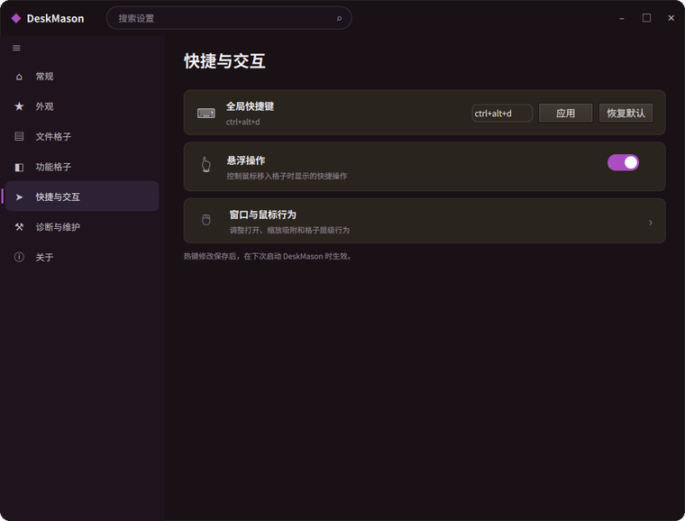
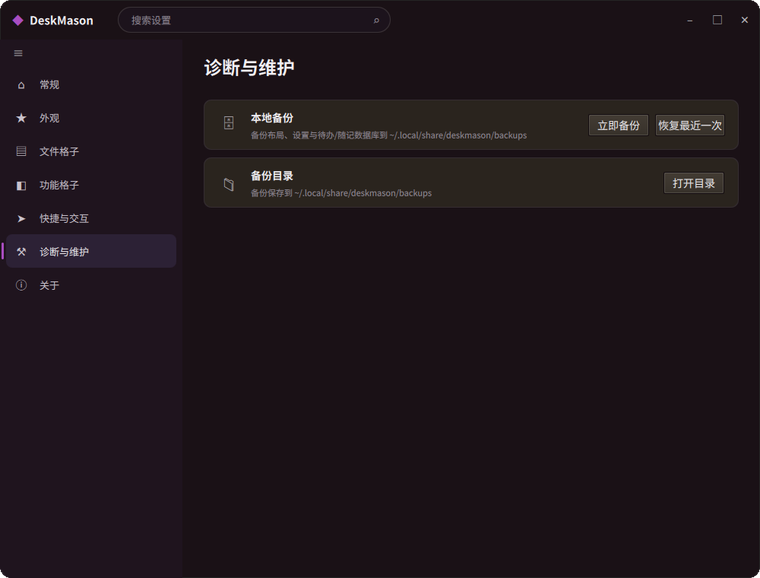
</p>

</details>

## 交互约定

- **拖动**：抓住瓦片顶部把手拖动，优先交给窗管做系统拖动，不支持时退回手动路径。
- **缩放**：拖四条边缘或四角改变尺寸；靠近相邻瓦片的边界会产生吸附对齐。
- **间隔**：新建与自动排布默认保留 40px 间隔；松手时如果瓦片边缘正好贴住相邻瓦片或屏幕四边，会自动退开 10px 留出可抓取的缝隙，方便下次再拖。
- **多屏**：所有瓦片强制约束在**主屏**工作区，启动时校正历史布局、拆开重叠并补齐最小间隔。
- **输入法**：只有含输入框的瓦片接受 X 键盘焦点，纯展示瓦片不抢焦点。
- **托盘**：托盘菜单只有五项——显示／隐藏、新建文件格子、设置、分隔、退出。
- **热键**：`Ctrl+Alt+D` 全局开关瓦片显示。

## 技术栈

| 层 | 选择 |
| --- | --- |
| 业务与平台 | Rust（edition 2021，rust-toolchain 1.96.0） |
| 界面 | Qt Quick / QML，Qt 6 |
| Rust ↔ Qt 桥接 | `cxx-qt`，把 Rust 的 QObject 与 invokable 暴露给 QML |
| 桌面层 | X11 / EWMH（`x11rb` + RandR），窗口类型与层级直接管理 |
| 本地存储 | JSON 布局档 + SQLite（待办、随记）+ 键值偏好 |
| 系统集成 | D-Bus / MPRIS、XDG autostart、StatusNotifierItem 托盘、X11 全局热键 |
| 打包 | deb（`packaging/build-deb.sh`） |

平台相关代码只允许出现在 `dm-platform`；其它 crate 不直接使用 `x11rb`、D-Bus 或 `/proc`。一个瓦片类型 = 一个领域模块 + 一个 QML 组件 + 一条注册项，新增类型不需要改宿主的分支逻辑。

## 运行环境

- **Deepin 25 / DDE，X11 会话**（KWin）。其它桌面环境与 Wayland / Treeland 组合目前不支持。
- Rust 1.85 以上（`rust-toolchain.toml` 固定 1.96.0）。
- Qt 6 开发包、CMake / Ninja、C++ 编译器、SQLite3、X11 开发库。

Deepin 25 上可先安装：

```bash
sudo apt install qt6-declarative-dev qml6-module-qtquick-controls \
                 qml6-module-qtquick-layouts cmake ninja-build clang \
                 libsqlite3-dev libxcb1-dev pkg-config
```

> 常规 Deepin 环境用系统默认工具链构建即可。`.cargo/config.toml` 与 `dev-env.sh`
> 只是当前开发机的沙盒桥接配置（含本机绝对路径），已从版本控制中排除；
> 在常规环境里请忽略或移除它们，避免覆盖本机工具链设置。

## 构建与运行

```bash
cargo build --workspace          # 构建全部 crate
cargo test --workspace           # 领域层、平台层、UI 层单元测试
cargo clippy --all-targets       # 静态检查
cargo fmt --all -- --check       # 格式检查

cargo run -p dm-app              # 启动桌面瓦片进程（二进制名 deskmason-ui）
cargo run -p dm-shell            # 无界面宿主进程
```

开发时可用 `DESKMASON_OPEN=settings` 直接拉起设置窗口。

QML 以资源形式嵌入二进制：**修改 `.qml` 后必须清理缓存再构建**，否则会加载到旧字节码：

```bash
cargo clean -p dm-ui && cargo build -p dm-app
```

打 deb 包：

```bash
packaging/build-deb.sh           # 产物在 target/deb/
```

## 目录结构

```
crates/
  dm-core/      领域模型：瓦片类型、几何、布局、设置与持久化格式
  dm-platform/  平台能力：X11 桌面层、显示拓扑、热键、托盘、文件操作、
                图标、壁纸、SQLite 存储、布局档读写（唯一平台边界）
  dm-shell/     无界面宿主进程
  dm-ui/        cxx-qt 桥、QML 界面、C++ 窗口胶水
  dm-app/       Qt 应用入口，按布局创建各瓦片窗口
packaging/      deb 构建脚本、desktop 文件、应用图标
translations/   翻译源文件与编译产物
```

## 数据与配置

| 路径 | 内容 |
| --- | --- |
| `~/.config/deskmason/widget-layout.json` | 瓦片布局（唯一真相），带 `schemaVersion` 与迁移 |
| `~/.config/deskmason/` | 偏好设置、UI 状态 |
| `~/.local/share/deskmason/` | 待办／随记 SQLite 数据库 |
| `~/.local/share/deskmason/backups/` | 本地备份（布局、设置、数据库） |

布局档在进程内有缓存，拖动与缩放按防抖节奏写盘，避免拖动时同步 I/O 掉帧。设置页提供本地备份与恢复。

## 已知限制

- 仅支持 Deepin 的 X11 会话；Wayland / Treeland 的 layer-shell 路径尚未实现。
- 全局热键 `Ctrl+Alt+D` 可能被其它程序占用，日志提示后程序继续运行。
- 天气与部分图标依赖本机网络／主题，离线时降级展示。
- QML 资源有编译缓存，改界面后需按上文清理 `dm-ui` 再构建。

## 许可证

`GPL-3.0-only`（见 `Cargo.toml` 的 `workspace.package.license`）。
